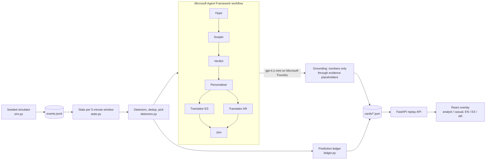

# Second Look

An AI sceptic for football. The scoreboard says one thing; Second Look checks whether the stat on screen is telling the whole story.

This is a public replay demo over synthetic data, not a production platform: no sign-in, no live feed, and the cards were generated ahead of time.

**Live replay:** https://second-look.victoriousbeach-1a6b5c87.eastus2.azurecontainerapps.io/ (the first visit after a quiet spell takes a few seconds while the app wakes up)

Deterministic detectors find where a headline number misleads: lots of shots but little quality, a scoreline the chances don't support, plenty of the ball but few trips into the box, or a team that stops pressing once it falls behind. Five agents then work it through as a broadcast-style overlay:

- **Hype** reads the stat at face value.
- **Sceptic** rebuts it with the deeper number.
- **Verdict** settles it, sometimes with a prediction that the match later proves right or wrong.
- **Personaliser** rewrites the Verdict for an analyst, for a casual fan and in the voice of each side's supporters.
- **Translators** turn everything into Spanish and Arabic, in parallel.

Every number an agent writes is checked against the evidence, and each agent falls back on its own if it fails, so the overlay is always complete.

## On screen

- **Scorebug** across the top: match clock, both teams and the score on each team's colours.
- **Pitch**: the current move as the players on the ball (shirt numbers, with the name of the one on the ball), passes as solid lines and dribbles as dashed ones, the ball where the last pass ended. The other side's presses and tackles show as crosses, and recent shots as lines to goal, thicker for a better chance. A key under the pitch explains each mark.
- **Lower third**: Hype, Sceptic and Verdict, with an evidence row that shows the surface stat, the deeper stat and the threshold between them.
- **Toggles**: Analyst or Casual; Neutral or a club to support ("My club"), which swaps the Verdict for that club's supporter line, so the same finding reads as "we" from one side and "they" from the other; English, Spanish or Arabic (right to left).

## Data and disclaimer

Fictional teams inspired by public playing-style analysis. Not affiliated with or endorsed by the Premier League or any club. All match events are synthetic; no real match data is used.

## Architecture



- **Detectors** (`detectors.py`): `volume_quality` fires at 8 or more shots under 0.08 xG per shot; `scoreline_xg` fires when the trailing team's rolling 30-minute xG beats the leader's by 1.0; `possession_penetration` fires at 60% or more possession with box entries per possession-minute under 0.6 times the opponent's (after 15 minutes); `effort_game_state` fires when a trailing team presses under 0.7 times its own rate from when it was level or ahead (10 minutes of each). One card per window: prediction calls first, then the original two detectors on close calls. A scoreline call becomes a prediction ("a goal is coming"), resolved by a goal before its deadline or expired.
- **Agents** (`agents.py`): one executor per agent in a `WorkflowBuilder` chain, with a fan-out to the two translators and a fan-in join. Each call has its own timeout inside a 25-second window budget and one retry when grounding rejects its reply.
- **Grounding** (`grounding.py`): model text may contain no digits and no typed-out team names; numbers and names enter only through `{placeholders}` filled from the evidence, formatted per language.
- **Fallbacks**: a failed agent keeps the cached line, else the template line, and each card records the true source of every piece (`live`, `cache` or `template`). The "Failure recovery" chip replays a run where the Sceptic was forced to fail.

## Microsoft technology used

| Technology | Where |
|---|---|
| Microsoft Agent Framework | The five-agent workflow with fan-out/fan-in (`agents.py`); its OpenTelemetry spans for every workflow run |
| Microsoft Foundry | `gpt-4.1-mini` deployment behind every agent, reached through the OpenAI-compatible endpoint with Entra ID sign-in (`llm.py`) |
| Azure Application Insights | Optional tracing of live card builds: each workflow run with every agent's model call, tokens and latency (`build_cards.py`, `uv run --extra tracing`) |
| Azure Container Apps | Hosts the public replay, scaling between 0 and 1 replicas |
| Azure Container Registry | Builds and stores the image (`az acr build`) |
| GitHub Actions | CI: ruff, pytest and the web build on every push |

## Run locally

### Replay (no credentials)

Needs [uv](https://docs.astral.sh/uv/) and Node 20.19+ or 22.12+ (Vite 8).

```bash
uv sync
npm --prefix web ci
npm --prefix web run build
uv run uvicorn second_look.api:app --port 8000
```

Open http://localhost:8000. The page opens on the first debate; the chips at the top jump to each key moment.

Or with Docker: `docker compose up`, then the same URL.

For UI work, run the API as above and `npm --prefix web run dev` (http://localhost:5173, proxies `/api`).

### Live agents

The committed cards in `cards/` were recorded from the live agents. To record your own:

1. Copy `.env.example` to `.env` and fill in a Microsoft Foundry deployment.
2. Check the provider answers: `uv run python scripts/smoke_llm.py`
3. Build live cards, then the recorded failure run:

```bash
uv run second-look-cards --source live
uv run second-look-cards --source live --seed demo --mode fail-sceptic
```

Reruns resume where they stopped; `--windows 6,11 --force` rebuilds chosen windows. Template cards need no provider: `uv run second-look-cards`.

Then check the Spanish and Arabic by back-translation: `uv run python scripts/backtranslate_qa.py` writes any string whose meaning changed to `qa/backtranslate.md` for review.

## Dataset and CLI

`uv run second-look-sim --help` generates synthetic matches from team profiles (`profiles/teams.toml`); the event format is in [SCHEMA.md](SCHEMA.md). Three seeds are committed in `data/seeds/`:

| Seed | Match | What it is |
|---|---|---|
| `demo` | North East London v Yorkshire Orange Black | **Scripted.** Goals are placed by hand (YOB about 22' and 51', NEL 78'), and NEL's style is set per spell: lots of the ball but few box entries and long-range shots to 35', less pressing once behind, box chances from 54'. The detectors and agents are not scripted: every card comes from running them over these events. |
| `random1` | Man Blue v East Anglia Town | Unscripted (seed 26). Goals are drawn from each shot's xG. |
| `even` | two evenly matched profiles | Unscripted (seed 11). No detector fires, which is the point: no misleading stat, no card. |

### How the predictions did

| Seed | Call | Deadline | Result |
|---|---|---|---|
| demo | 60': a goal is coming for North East London | 85' | Called it: NEL scored at 78' |
| demo | 80': a goal is coming for North East London | 90' | Missed |
| random1 | 30': a goal is coming for Man Blue | 55' | Missed |

One hit in three. The misses stay in the replay on purpose: a sceptic that is never wrong would not be worth trusting.

## How it meets the brief

| Brief | Where |
|---|---|
| (i) a. Ingest synthetic events | The replay walks each seed's events in 5-minute windows (`pipeline.py`) |
| (i) b. Interpret into stats | Per-team shots, xG, xG per shot, shot distance, rolling 30-minute xG, possession share, box entries and pressing rate by game state (`stats.py`) |
| (i) c. Explain why it matters | Detectors name the misleading stat; Sceptic and Verdict explain it |
| (i) d. Render on screen | Scorebug, a pitch view of each move, broadcast lower third, outcome cards and an evidence row with a rolling-xG sparkline, timed to the match clock |
| (i) e. Personalise | Analyst and casual Verdicts, a supporter's Verdict for the viewer's favourite club ("My club"), plus three languages |
| (ii) Real-time intelligence | Window-by-window stats and detection, each card produced inside a 25-second budget. Player tagging, pass quality, speed metrics and auto-eventing are not covered |
| (iii) Narrative generation | The debate, predictions and their payoff ("Called it", "Missed"). Full match recaps are not covered |
| (iv) Explainability | The core of the project: every card shows the surface stat, the deeper stat and the threshold between them. Four detectors cover shot quality, the scoreline, control without penetration and effort by game state |
| (v) Data innovation | A seeded simulator with team profiles and a documented event schema |
| (vi) Multi-language | English, Spanish and Arabic (right to left), with a back-translation check |

## Deploy

The public deploy is replay-only: no model credentials, no secrets.

```bash
az acr build -r <registry> -t second-look:v1 --no-logs .
az containerapp create -n second-look -g <resource-group> --environment <environment> \
  --image <registry>.azurecr.io/second-look:v1 --registry-server <registry>.azurecr.io --registry-identity system \
  --ingress external --target-port 8000 --min-replicas 0 --max-replicas 1
```

`--no-logs` avoids an Azure CLI crash on Windows when it prints build logs.

## Layout

```
src/second_look/   Python package
  sim.py             seeded match simulator (CLI: second-look-sim)
  stats.py           per-team aggregates at each 5-minute boundary
  detectors.py       the four detectors, dedup and window pick
  ledger.py          predictions: fulfilled by a goal or expired at the deadline
  templates.py       deterministic EN/ES/AR card text
  agents.py          Hype -> Sceptic -> Verdict -> Personaliser -> Translators ES || AR (Microsoft Agent Framework)
  grounding.py       numbers and names only through evidence placeholders
  llm.py             model client with ordered provider fallback
  pipeline.py        cards from events, card cache read/write
  build_cards.py     card builder (CLI: second-look-cards)
  api.py             replay API and the built UI
  contracts.py       shared data models (mirrored in web/src/contracts.ts)
  config.py          paths and settings
  prompts/           agent prompts
web/               React + Vite replay UI (components/, usePlayback.ts)
profiles/          fictional team profiles
data/seeds/        committed synthetic matches
cards/             committed overlay cards
tests/             pytest suite (no test calls a real model)
scripts/           developer checks
```

## Tests

```bash
uv run pytest -q
uv run ruff check .
npm --prefix web run build
```

`tests/test_cards_lint.py` checks every committed card: word limits, no digit outside the evidence and every language present.

## Licence

MIT. See [LICENSE](LICENSE).
